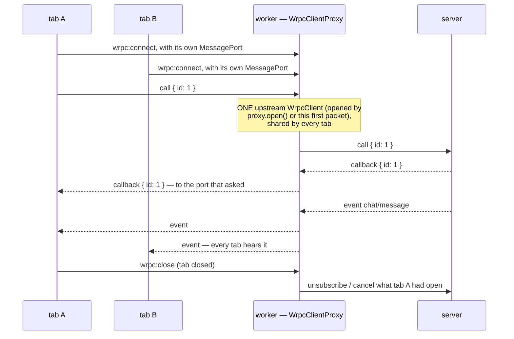

# Browser & bundling

The same protocol implementation runs in Node.js and in a browser — not a
reimplementation, not a subset of the wire format. What differs is which
*files* the bundler picks, and this page is about that machinery: how the swap
happens, what lands in your bundle, and what is deliberately absent.

## Nothing to configure

```js
import { WrpcClient, connect } from '@alexify/wrpc';

const client = await connect('wss://api.example/api');
await client.load('chat');
```

Any bundler that honours the `browser` field or the `browser` export condition
resolves that import to the browser build automatically: webpack, Vite, esbuild
with `platform: 'browser'`, Rollup (`@rollup/plugin-node-resolve` with
`browser: true`), Parcel, Bun.

## What gets swapped

Two mechanisms, both declared in `package.json`:

| Node file | Browser file | Why |
| --- | --- | --- |
| `index.js` | `src/index.browser.js` | The browser barrel excludes the server half entirely. |
| `src/sse/index.js` | `src/sse/client.js` | A browser needs the [SSE](./sse) client transport, never the channel registry. |
| `src/webrtc/index.js` | `src/webrtc/browser.js` | A browser peer needs the [WebRTC](./webrtc) peer, link and signaler client, never the server-side signaling unit. |
| `src/encryption/index.js` | `src/encryption/browser.js` | The [encryption](./encryption) primitives over `crypto.subtle`, without the Node-only sealed store and replay cache. |
| `src/chunks.js` | `src/chunks.browser.js` | `Buffer` vs `TextEncoder`/`TextDecoder` for [binary framing](./streams). |
| `src/runtime/node.js` | `src/runtime/browser.js` | `node:crypto` vs `globalThis.crypto` for id generation. |

The first four are the `browser` condition of each entry in `exports` — every
subpath resolves straight to its file under `src/`, nothing at the package root
but the main entry. The legacy `browser` field carries the main entry and the
halves inside `src/` that a file requires (which `exports` cannot reach), so a
resolver gets the browser build whichever of the two it reads; the subpaths
themselves need one that reads `exports`, as every bundler named above does.

## What is in the browser entry

```js
Emitter, WrpcClient, WrpcClientProxy, WrpcError, connect,
WrpcReadable, WrpcWritable, chunkEncode, chunkDecode,
EventStream, createEventStream
```

That is the whole runtime surface — and it contains **no Node builtins**, so
nothing pulls in a polyfill for `node:http`, `node:crypto`, `node:zlib` or
`Buffer`.

::: warning Server exports are not in the browser build
`Server`, `RpcServer`, `defineRouter`, `procedure`, `RoomRegistry`,
`MemorySessionStore`, `ServerTransport` and friends exist only in the Node
entry. Importing one in browser code is a build error, not a runtime surprise —
which is the point of splitting the barrels rather than tree-shaking one.
:::

### Types without `@types/node`

`src/index.browser.d.ts` (the `browser` types condition) re-exports
`src/client.d.ts` and nothing else, so browser consumers never inherit the
Node type dependencies that `index.d.ts` carries. That split is why a
front-end `tsconfig` with no `"types": ["node"]` type-checks cleanly
against `@alexify/wrpc`.

Note the asymmetry: the browser *types* include wire-packet interfaces and
other type-only declarations that have no runtime counterpart. Types are
erased; imports are not.

## Bundle size

Measured with `pnpm size`, which bundles each entry with esbuild and reports
min+gzip. Browser-reachable entries carry a **budget**, and exceeding one fails
the run — it is a ratchet, and it runs in CI's lint job.

| Entry | min | min+gzip | budget |
| --- | ---: | ---: | ---: |
| `@alexify/wrpc` — browser | 90.0 KB | **30.3 KB** | 31.0 KB |
| `@alexify/wrpc/sse` — browser | 93.7 KB | **31.5 KB** | 32.0 KB |
| `@alexify/wrpc/query` | 2.7 KB | **1.1 KB** | 2.0 KB |
| `@alexify/wrpc/auth` | 3.9 KB | **1.8 KB** | 2.0 KB |
| `@alexify/wrpc/deflate` | 10.7 KB | **4.4 KB** | 5.0 KB |
| `@alexify/wrpc/encryption` — browser | 31.8 KB | **11.6 KB** | 12.0 KB |
| `@alexify/wrpc/webrtc` — browser | 189.1 KB | **62.2 KB** | 63.0 KB |
| `@alexify/wrpc` — node | 316.8 KB | 106.7 KB | — |

The Node-only entries carry no budget because their gzip size is not a shipping
cost; they are measured so a regression is *visible*, not gated.

The SSE entry is the browser entry **plus** the SSE transport — you pay the
extra kilobyte only if you import it. [`@alexify/wrpc/deflate`](./compression#deflate)
and [`@alexify/wrpc/encryption`](./encryption) sit outside every other entry:
only a page that imports them pays for them. The [WebRTC](./webrtc) entry is a client
**and** a server (a peer serves a router), which is what its budget buys.
[`@alexify/wrpc/query`](./query) requires nothing at all (that is what keeps it
at 1 KB); it takes the client and your `QueryClient` by injection.

::: tip Raising a budget
A budget is a ratchet with a documented escape hatch: if bytes are genuinely
earned, raise the number in `scripts/size.js` in the same change, with a
comment saying why.
:::

## Transports in a browser

| Transport | Use it when |
| --- | --- |
| `ws` (default) | Normal. Full duplex, binary streams, every feature a connection carries. |
| `http` | One-shot calls with no connection — no events, no subscriptions, no streams. |
| `sse` | WebSockets are blocked by a proxy or corporate network. Text only. |
| `wt` | [WebTransport](./wt) over HTTP/3 (experimental): binary streams that do not block each other or the calls, unreliable events; `['wt', 'ws']` falls back where the browser has none. In the main entry — nothing to import. |
| `event` | The connection lives in a worker — a Service Worker or a SharedWorker; the page talks over a `MessagePort`. |
| `webrtc` | Peer to peer: the other end is another browser (or a Node process), reached through a [`WrpcPeer`](./webrtc)'s `link` or a data `channel` you negotiated yourself — not a URL. |

`WrpcClient.transport` is a plain lookup table on purpose, and a subpath
entrypoint registers into it at require time — which is how `@alexify/wrpc/sse`
adds `'sse'` without the core knowing it exists. Registering your own works the
same way.

## Workers: Service Worker and SharedWorker

The `event` transport is how one socket serves every tab and survives a page
reload: the worker holds the connection, the page talks to the worker over a
private `MessagePort`. The worker side is the same `WrpcClientProxy` whichever
kind of worker it is.

```js
// in the Service Worker
const proxy = new WrpcClientProxy({ callTimeout: 7000 });
await proxy.open();

// in the page
const client = await WrpcClient.connect(url, { worker: navigator.serviceWorker.controller });
```

```js
// in the shared worker (wrpc-worker.js)
const proxy = new WrpcClientProxy({ url: 'wss://api.example.com' });
await proxy.open();

// in the page
const worker = new SharedWorker('/wrpc-worker.js', { name: 'wrpc' });
const client = await WrpcClient.connect(url, { worker });
```



The packets are identical on both hops, so nothing above the transport changes
— [binary attachments](./streams#attachments) included: a frame crosses the
port as bytes and is routed by the packet inside it, an answer to the tab
that asked, an event to every tab. [Binary streams](./streams) cross too,
although a chunk carries nothing but its stream id: the proxy routes it by
the stream's announcement. An upload's chunks go up only from the tab that
announced it, and a server stream's chunks go down wherever its `stream`
packet went. The receiver's word that a stream is
[no longer wanted](./streams#ended-by-the-receiver) is routed the same way:
the server's reaches the tab that announced the upload, a tab's goes up, and
the stream's end comes back to every tab that was handed it.

A server-opened stream is handed to **every tab that was open when it was
announced** — the worker cannot know which of them asked for it — so each has
a copy until it reads it or drops it. A tab that never reads its copy lets it
go by itself: after [`streamIdleTimeout`](./streams#limits), or at its
`maxStreamBuffer`, and without a word to the server — the tab that is reading
goes on. A tab that opens later is sent none of a stream it never heard
announced. And once **no** tab that held the stream is left, the worker tells
the server to stop sending it, as a tab's own reader would.

Pick the worker by what you need from it: a **Service Worker** also serves the
page offline and outlives a reload, at the price of registration and a
lifecycle the browser controls; a **SharedWorker** is only the shared socket —
no registration, alive exactly as long as a tab of the site is — and can point
at another origin through the proxy's `url`. `worker` also takes a dedicated
`Worker` or a raw `MessagePort`. See [Client → Workers](./client#workers).

::: warning Browser support
SharedWorker reaches most of the mobile web now (Chrome and Firefox for
Android, recent Safari on iOS), but Samsung Internet and Opera Mobile still
don't ship it — feature-detect (`typeof SharedWorker !== 'undefined'`) and
fall back to a direct connection rather than assuming it. The proxy releases
a closed tab's port on the page transport's goodbye (`close()` on the
client) and on the `MessagePort` `close` event; a tab that vanishes without
either, on an engine that never fires the event, keeps its entry until the
worker goes — as it always has for a Service Worker. A release cancels what
the tab was still waiting for upstream (its calls, its subscriptions), and
an answer arriving for a tab that left is dropped, never handed to the
others; events still reach every tab, and a server-opened stream every tab
that was there when it was announced.
:::

The client also listens to `online`/`offline`: going offline stops the
reconnect timer instead of burning retries, and coming back reconnects
immediately rather than waiting out the backoff.

## Frameworks

The client is framework-agnostic and has no React/Vue/Svelte bindings by
design. For data fetching, [`@alexify/wrpc/query`](./query) returns TanStack
Query **option factories** — not hooks — so one 1 KB file serves React, Solid,
Svelte and Vue Query alike.

One thing to know when wiring a framework: `client.api` does not exist until
`load()` resolves, and it is **rebuilt on every reconnect**. Resolve paths
lazily inside the query function rather than capturing `client.api.chat.list`
at module scope — which is exactly what the query bindings do.

## CommonJS in an ESM world

The package is CommonJS and ships without a build step. Every modern bundler
handles that, and `import { WrpcClient } from '@alexify/wrpc'` works through
interop. If you are running a bundler-free `<script type="module">` setup with
no build at all, bundle the package yourself — there is no prebuilt ESM
artifact, on purpose: one shipped shape means one thing to audit.
