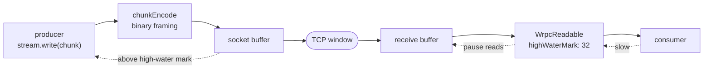

# Binary streams

Calls carry JSON. For bytes — a file upload, a video download, anything big
enough that buffering it would be a mistake — wRPC has a second framing:
**binary chunks**, interleaved on the same connection.

Two objects, one on each end:

- **`WrpcWritable`** — the sending side. `write(chunk)` reports whether the
  transport accepted it; `end()` closes the stream.
- **`WrpcReadable`** — the receiving side. Async-iterable, or `pipe()` into a
  node `Writable`, or `toBlob()` in a browser.

The stream id prefixes every chunk, which is what lets several streams
interleave over one connection without head-of-line blocking. Streams need a
persistent, binary-capable transport: not HTTP, and not [SSE](./sse).

## Uploading

Announce the stream, call the procedure with its id, then push the bytes:

```js
// client
const blob = new Blob([bytes]);
blob.name = 'video.mp4';                  // optional; defaults to 'blob'
const uploader = client.createBlobUploader(blob);

const receiving = client.api.media.receive({ id: uploader.id });
await uploader.upload();
console.log(await receiving);
```

`upload()` is paced by the transport — a chunk it did not accept waits for
the stream's `'drain'` — and rejects with a `503` `WrpcError` when the
connection closes before the last chunk went, instead of resolving with the
rest gone nowhere; a source that fails mid-way terminates the stream on the
server, which stops waiting for its end. When it is the server that ends the
stream under the upload, `upload()` rejects with
[the server's reason](#ended-by-the-receiver).

```js
// server
receive: procedure({
  handler: async (context, { id }) => {
    const stream = context.client.getStream(id);
    for await (const chunk of stream) {
      await sink.write(chunk);
    }
    return { name: stream.name, size: stream.size };
  },
}),
```

Note the order: the call is issued **before** the upload finishes. The handler
gets the stream as soon as its opening packet has arrived and consumes chunks
as they land — the call's promise resolves when the handler returns.

Without a `Blob`, hand a `WrpcWritable` the bytes:

```js
const stream = client.createStream('report.csv', bytes.length);
const receiving = client.api.media.receive({ id: stream.id });
await stream.writeAll(bytes); // 64 KiB at a time, each when the transport takes it
stream.end();
```

`writeAll(bytes, chunkSize?)` is the loop you would otherwise write — a piece
the transport did not accept waits for `'drain'` — and answers whether every
byte went: `false` once the connection closed, the
[receiver ended the stream](#ended-by-the-receiver), or the stream was ended
or terminated under it. It never rejects for a closed transport and never
ends the stream, so several buffers make one stream. To feed it from a source
of your own, the loop is under [Backpressure](#backpressure).

The `size` you announce is a promise the other end holds you to: write
exactly that many bytes before `end()`, or `terminate()` — see
[the announced size](#size).

## Downloading

The same machinery, mirrored:

```js
// server
download: procedure({
  handler: async (context, { name }) => {
    const payload = await load(name);
    const stream = context.client.createStream(name, payload.length);
    queueMicrotask(async () => {
      await stream.writeAll(payload);
      stream.end();
    });
    return { id: stream.id };
  },
}),
```

```js
// client
const { id } = await client.api.media.download({ name: 'report.csv' });
const readable = client.getStream(id);

const blob = await readable.toBlob('text/csv');   // browser
readable.pipe(fs.createWriteStream('report.csv')); // node
for await (const chunk of readable) { /* ... */ }  // either
```

`createStream()` sends the opening packet immediately, so writing from inside
the same tick as the `return` would race the caller's chance to register a
consumer — hence the `queueMicrotask`. And `writeAll`, not one `write` of the
whole payload: written whole it is a single message, which nothing paces and
an engine's message limit refuses once the payload is large enough.

## Backpressure

This is the part that makes streams usable for real payloads, and it works end
to end:

```js
if (!stream.write(chunk)) {
  await new Promise((resolve) => stream.once('drain', resolve));
}
```

`write()` returns the **transport's real answer**: `false` means the socket
buffer is above its high-water mark. Wait for `'drain'` before writing more.
A transport with no flow-control reporting (a browser `WebSocket`, HTTP)
always reports accepted.

`false` can also mean the stream was closed under you — the transport went
away, or the [receiver ended the stream](#ended-by-the-receiver) — and no
`'drain'` will ever follow: check `stream.closed`, or listen for `'close'`.

On the receiving side, `WrpcReadable` applies its own high-water mark
(`highWaterMark`, 32 chunks by default) once a consumer has attached, and the
server pauses socket reads while chunks are being consumed. So a slow consumer
pushes back through the queue, through the socket, and into TCP — the producer
on the other end sees `write()` return `false`. Nothing between them buffers
without bound — and what arrives before there is a consumer is bounded by
[`maxStreamBuffer`](#limits).



Every dotted arrow is one hop of the same signal travelling backwards: a slow
consumer pauses socket reads, TCP stops moving bytes, the sender's buffer fills,
and `write()` starts answering `false`. Nothing in between buffers without
bound.

::: tip Verified, not asserted
`tests/perf/stream-memory.perf.js` (`pnpm test:perf`) streams 1 GiB through and
fails if RSS grows with it.
:::

## Lifecycle

| Call | Effect |
| --- | --- |
| `writable.end()` | Normal end, after exactly `size` bytes. The reader's iteration finishes. |
| `writable.terminate()` | Abnormal end — the reader stops where it is. |
| `readable.close()` | Waits for the announced `size` to be read, then closes. |
| `readable.terminate()` | Stops now, discarding what is queued — and [tells the sender](#ended-by-the-receiver), which stops sending. |
| `readable.terminate(message, code?)` | The same, with a reason the sender's writable closes with. |

A disconnect terminates every stream the client held. `readable.status` is
`'active'`, `'closed'` (every announced byte was read) or `'terminated'`;
`bytesRead` is what has been consumed so far, against the announced `size`.

### A stream the receiver ended {#ended-by-the-receiver}

A receiver can end a stream before its sender does, and says so — once, on
the stream's id — so the sender stops instead of sending a body that is
dropped on arrival:

| The receiver… | The sender's `writable.error` |
| --- | --- |
| let go of it: `readable.terminate()` — a handler refusing an upload, a page dropping a download | `499`, `Stream … is no longer read` |
| let go of it with a reason: `readable.terminate(message, code)` | that message and code (`499` unless given) |
| was sent more than [the announced size](#size) | `400` |
| holds more unread than [`maxStreamBuffer`](#limits) allows (a server) | `413` |
| has too many streams open ([`maxStreams`](#limits), a server): the announcement itself is refused | `429` |

The word reaches the `WrpcWritable` the stream belongs to, on either end:

```js
// client — an upload
const stream = client.createStream('report.csv', bytes.length);
const receiving = client.api.media.receive({ id: stream.id });
if (!(await stream.writeAll(bytes))) {
  // Closed under the writer: `error` is the receiver's reason — on a client
  // a WrpcError with the server's code — and null when it was the
  // connection that went away.
  throw stream.error ?? new Error('Connection lost');
}
stream.end();
```

```js
// server — a download the page may drop half-way
const stream = context.client.createStream(name, size);
queueMicrotask(async () => {
  for await (const piece of source) {
    if (!(await stream.writeAll(piece))) break; // the page let go (499), or left
  }
  stream.end(); // a no-op on a stream that is already over
  source.destroy?.();
});
```

From that moment the writable is over: `write()` answers `false`,
`writeAll()` resolves `false`, `closed` is `true`, `'close'` is announced —
exactly what a lost connection does, so a loop that already watches `closed`
stops without a change — and `stream.error` says why, which a lost connection
never does. Nothing more of the stream is sent but a `terminate`, which lets
the receiver forget it. `createBlobUploader().upload()` rejects with the same
error.

To refuse an upload with something the uploader can show, give the reason
as you let go:

```js
receive: procedure({
  handler: async (context, { id }) => {
    const stream = context.client.getStream(id);
    if (stream.size > quota) {
      await stream.terminate('This file is larger than your plan allows', 413);
      return { stored: false };
    }
    // …
  },
}),
```

It is still the quiet end on this side — the reader's loop stops, `error`
stays `null` — and the uploader finds the message and the code on
`stream.error`.

Three things are worth knowing about it:

- **The word is for bytes still to come.** A reader that lets go of a stream
  that has arrived whole tells nobody, reason or not: there is nothing left
  to stop, and what the reader made of the stream is the answer of the call
  that named it. A small upload has usually arrived whole by the time its
  handler runs.
- **An answer that arrives after `end()` has nobody to stop** — a stream
  small enough to be written and ended in one turn is always answered late.
  A failure is then raised on the client's `'error'` event (the server's
  own error, with its message and code) or logged by the server; a `499`
  that crossed the end of its stream is nobody's error and is dropped.
- **A reader's letting go is said only to a sender that asked.** A stream's
  announcement carries `cancel: true` when its sender listens — every
  `createStream()` newer than 2.0.1 does. A 1.0 or 2.0.1 peer does not ask and
  is not told (it would report a callback nobody waited for): it goes on to
  its own `end`, and every chunk it still sends is dropped on arrival, as
  before. Nor does a 1.0 or 2.0.1 receiver ever say it. Nothing needs
  setting, and the [protocol page](../reference/protocol#stream-both-directions)
  has the packets.

Behind a [worker proxy](./browser) the word crosses the worker both ways,
routed like the stream it is about. Over [WebTransport](./wt) it
travels on the control stream, and the sender answers by resetting the
stream's own WebTransport stream.

### The announced size {#size}

`size` is what the sender says it will send, in bytes, and the receiving end
holds it to that. Zero is a size: an empty file is a stream of no chunks,
announced and ended, and its reader's iteration finishes without a turn —
in both directions.

A sender that does not keep its word **fails** the stream, in either of two
ways: a chunk that takes it past the announced size, or an `end` that comes
short of it. A failed stream is over — `status` is `'terminated'`, what was
queued is let go of — and its reader is told why: `readable.error` holds the
reason, the `for await` over it **throws** it, `toBlob()` rejects with it,
and `pipe()` destroys its sink with it.

```js
receive: procedure({
  handler: async (context, { id }) => {
    const stream = context.client.getStream(id);
    for await (const chunk of stream) await sink.write(chunk); // throws: "Stream … ended at 4 of 10 bytes"
    return { size: stream.bytesRead };
  },
}),
```

The error carries `code: 400`, so a handler that lets it through answers its
caller `400` with the reason. On a server the sender is told as well, once:
a `callback` error packet with the stream's id — `400` for the size — which
[ends the sender's writable](#ended-by-the-receiver), and whatever it still
sends into that stream is dropped. A stream that failed before anybody read
it is kept for its reader: `getStream(id)` still answers it, and reading it
throws the reason.

`writable.terminate()` and a disconnect stay the quiet end — the reader's
loop simply stops, with `status` `'terminated'` and `error` `null`. A loop
that ended is therefore not yet a file that arrived: check
`readable.status === 'closed'` (or `bytesRead === size`) before trusting it.

### Limits {#limits}

A connection holds at most [`maxStreams`](./server#rpc-options) streams at
once (256 by default): a stream is announced by the peer, and holds a
readable — with what was sent into it — until a handler reads it, so the
number is the peer's to choose and the cap the server's. Past it the
`stream` packet answers `429` (`stream.capacity` in the log, at debug).

What those streams hold is capped too. The high-water mark of the
[backpressure](#backpressure) above needs a reader — a readable cannot hold
the socket back for a handler that a later packet on that same socket
starts — so until one attaches every chunk is kept, and the announced size
bounds nothing: it is the peer's word. [`maxStreamBuffer`](./server#rpc-options)
(64 MiB by default) is the most one connection may have sent into streams
nobody reads yet. The stream whose chunk goes past it fails — its bytes let
go of, its sender answered `413` (`stream.buffer` in the log, at debug), its
reader, if one comes, thrown the same — and the connection's other streams
keep what they had. A stream being read is not counted, however large: it is
paced, not held.

So issue the call **before** the upload, as above. The other order — the
whole upload first, then the call that reads it — works for as long as the
upload fits under `maxStreamBuffer`, and holds all of it in memory until the
handler starts.

## Bytes inside a call, not as a stream {#attachments}

A stream is for bytes that do not fit in memory or should not wait for
their end. Bytes that *do* fit — an avatar, a thumbnail, a signature, a
serialized model — belong in the call, and they can simply be put there:

```js
await client.api.files.put({ name: 'avatar.png', body: pngBytes }); // a Uint8Array
const { thumbnail } = await client.api.files.get({ id }); // arrives as a Uint8Array
context.client.sendEvent('files/ready', { preview: bytes });
```

Any typed array, `ArrayBuffer` or `DataView` anywhere in a packet's args,
result, event data or error details travels as **binary attachments**: the
packet's JSON goes out with `null` at each byte leaf and an index of where
the leaves were, the buffers follow in the same frame, and the other end
puts them back — as fresh `Uint8Array`s that own their bytes. No base64
(a third more), and none of what `JSON.stringify` makes of a typed array
otherwise: a `{"0":137,"1":80,…}` object nine times the size that used to
arrive silently as a plain object. Every transport carries it — a binary
WebSocket frame, a WebTransport or data-channel message, a broker session frame, a
worker port, an HTTP body under `application/octet-stream` — except SSE,
which is text-only: it speaks [revision 1](./sse#what-it-cannot-do) to
every client, so bytes on it travel as the JSON objects 1.0 made of them.

On by default between two 2.x ends. The frame is
[revision 2](../reference/protocol#versioning) of the protocol, negotiated
per connection, so a 1.0 peer is never sent one: its bytes arrive — and are
sent — as the plain objects 1.0 made of them, and `client.revision` (on the
client, and on `context.client` in a handler) says which kind of connection
this is. The cost is a walk of every outbound packet to find the bytes
(`bench/attachments.js`: tens of nanoseconds on a small callback, a few
microseconds on a 30 KB one); `attachments: false` skips it and makes that
end speak revision 1 — JSON, to everyone. Under a packet [codec](./codec)
it is off by itself — the codec owns the wire. A REST
result holding bytes needs `codec.rest` and answers `501` without it. A
room event with bytes crosses the [backplane](./scaling) too: its envelope
rides as the same frame, base64 under a `wrpc-bin:` marker (or inside the
sealed envelope, under `rooms.encryption`), and the members on another
instance receive bytes.

Two things the walk leaves to JSON. An object with a `toJSON()` **is its
projection**: what `toJSON()` answers is what travels, and a typed array
kept behind it (a password hash on a user entity, say) is never lifted out
and sent — put the bytes in the projection if they should go. And a packet
with a cycle in it answers `false` to the walk and is handed to
`JSON.stringify`, whose "Converting circular structure" `TypeError` is the
one you would have seen anyway; the walk itself stays linear on a graph
with back-references (a parent every child points at), where a walk with
no memory of what it visited would take 12^16 steps.
The frame's layout is on the [protocol page](../reference/protocol#binary-chunks).

## Chunk framing

Each binary frame is one chunk of one stream:

```
┌────────┬──────────────────┬──────────────────────────┐
│ 1 byte │  id (idLength)   │        payload           │
│ idLen  │  utf-8 stream id │        bytes             │
└────────┴──────────────────┴──────────────────────────┘
```

`chunkEncode(id, payload)` / `chunkDecode(chunk)` are exported if you need to
speak it yourself. The Node build uses `Buffer`, the browser build
`TextEncoder`/`TextDecoder` — swapped through the package's `browser` field, so
you never choose. Full details in
[the wire format reference](../reference/wire-format#binary-chunks).
